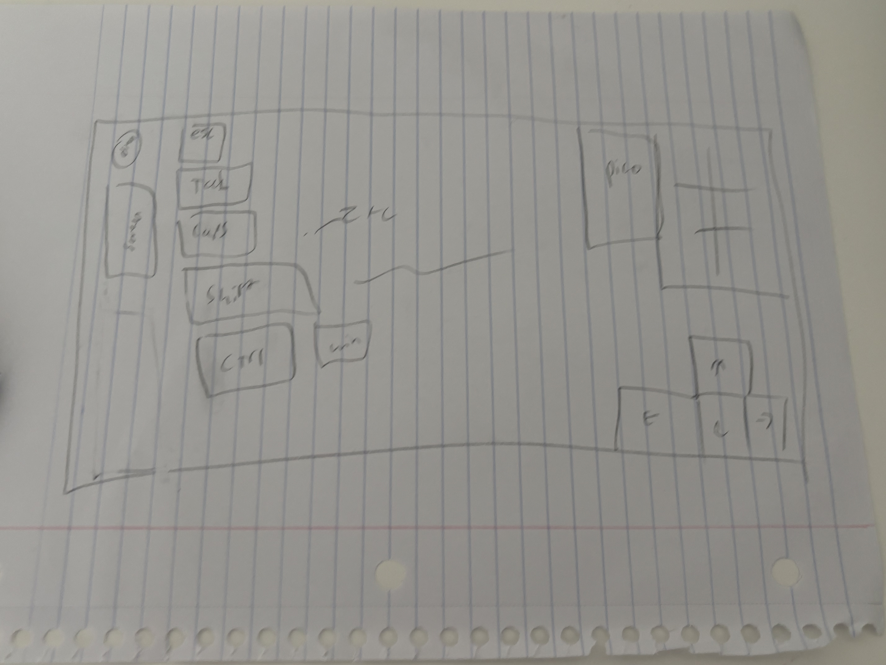
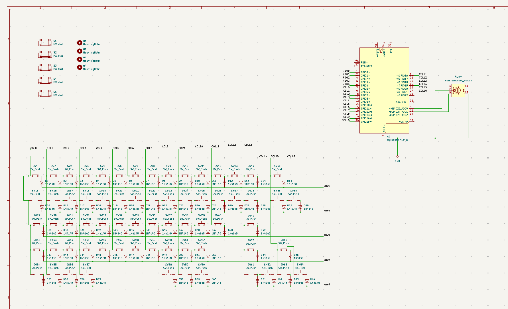
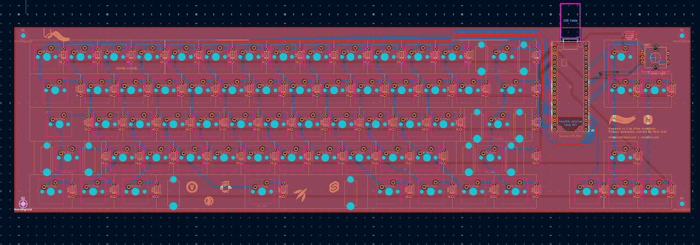
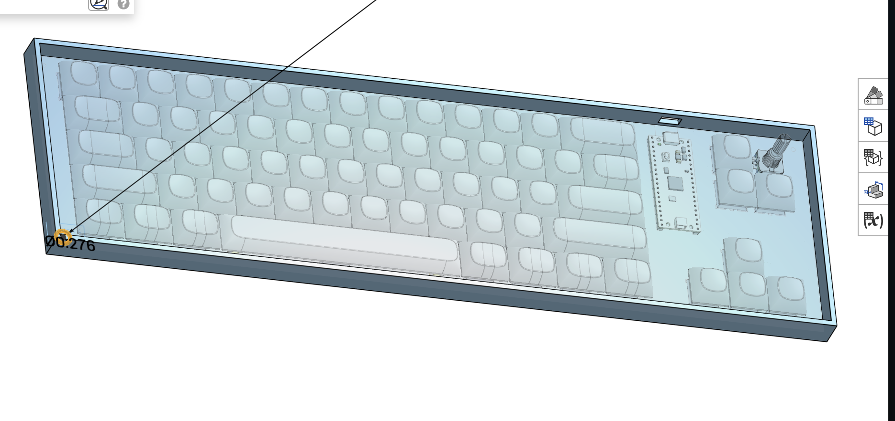
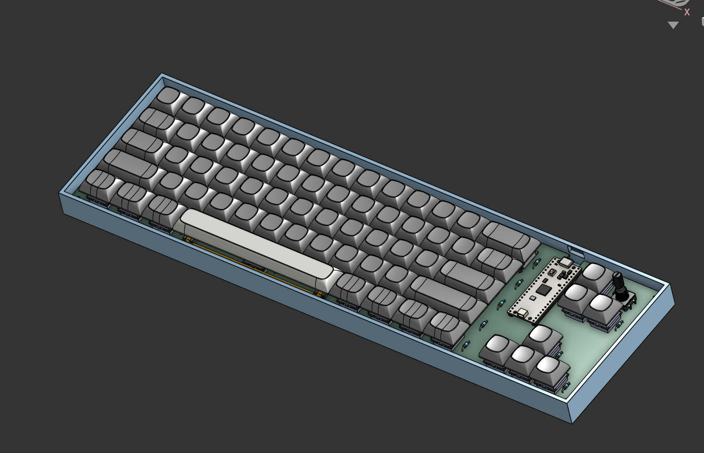
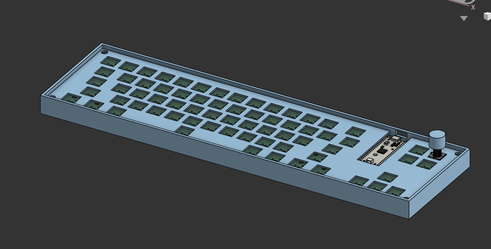
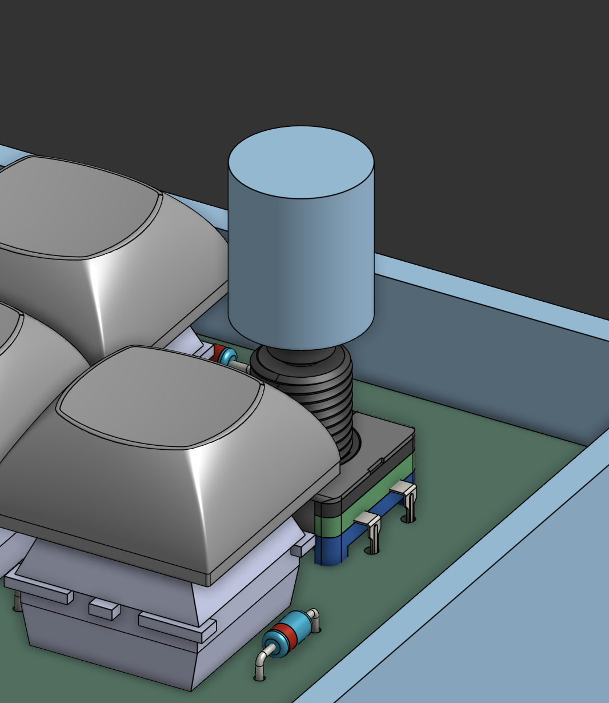
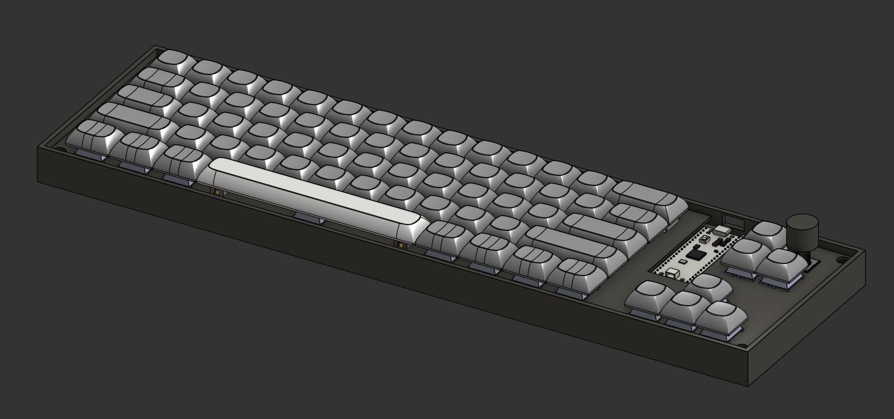

# #1: GitHub Repo and Planning

- **Date:** July 9, 2026

I spent about an hour setting up the GitHub repo and doing research on different types of keyboards and layouts. I decided on a rotary encoder and a screen, with a 65% layout and tactile switches. I considered an OLED screen but I felt like it was out of scope for my first keyboard project.

*my rough layout on paper as I tried to figure out what the keyboard would look like*

**Total time spent: 1h 30m**

# #2: Schematic

- **Date:** July 10 2026

I put together the keyboard schematic in KiCad using a Raspberry Pi Pico, 68 key switches, and a diode for each key. I also included a rotary encoder with a push switch. It took me a while to settle on layout design and just get the general feel for kicad, as well as understanding how keyboards work under the hood. I'm following [keeb's](https://keeb.hackclub.com/docs/getting-started/) tutorial for this project.

**Total time spent: 2h 30m**

# #3: YAY TRACING!!! and layout

- **Date:** July 12 2026

I laid out the keyboard PCB in KiCad, arranging the switch footprints into the keyboard layout and placing the diodes, Pico, and encoder. This ended up taking much much longer than I initially expected because as I went to design I identified many pitfalls in my schematic etc, so I had to go back and modify the layout and schematic multiple times. I then did all the tracing. I had to add room at the top of the board and build a recess for the usb cable bc the traces took up more space than I initially thought. I also added a decent amount of silkscreen with things that are relevant to me! I'm not the best artist so I wasn't able to make it super cool or anything, but svgs of things relevant to me was good enough for now!

**Total time spent: 6h**

# #4: Case

- **Date:** Oct 11 2026

Woohoo I finally got the motivation to pick this project back up after like 3 months!!
Time for the case. I've never used onshape before so it took me a little bit to get used to it, but now that I've gotten used to it I now have a basic tray style case. I still need to make the screw holes for the tray and the top plate. Figuring out how they all interface cleanly in cad is just a little bit confusing.

**Total time spent: 3h**

# #5 Case pt2

- **Date:** Oct 14 2026

I spent a really long time learning more about onshape. I learned about mate connectors and how to fit everything together, and I spent quite a while mateing everything together and then after doing so I realized some of my dimensions were off, so I had to go back and modify quite a few thigns in the case to make sure that everything will work nicely together.

**Total time spent: 1h 30m**

# #6 Case pt3 (plate)

- **Date:** Oct 14 2026

I think the plate was the hardest part of building the case; ensuring I was building it in the right place and getting dimensions and spacing right is really hard. I didn't add spaces for my stabilizers because it's hard to model for the stabs if I don't know exactly which model I'm going to use (I haven't put my bom together yet)

I also modeled the cap for the rotary encoder.

**Total time spent: 3h 30m**

# #7 final board yay

- **Date:** Oct 15 2026

I finished!! (for the most part; plate doesn't have stabs because they're not super standard so I'll cad them in when the stabs arrive) 
I added a material to the case and put together a bom, and did the final assembly!

**Total time spent: 30m**

# #8 fixing things for review

- **Date:** Oct 25 2026

After being rejected once, I added chamfers to my case to improve the aesthetic and also added more 3dmodels to my repo, and improved a few other things.

**Total time spent: 5m**
