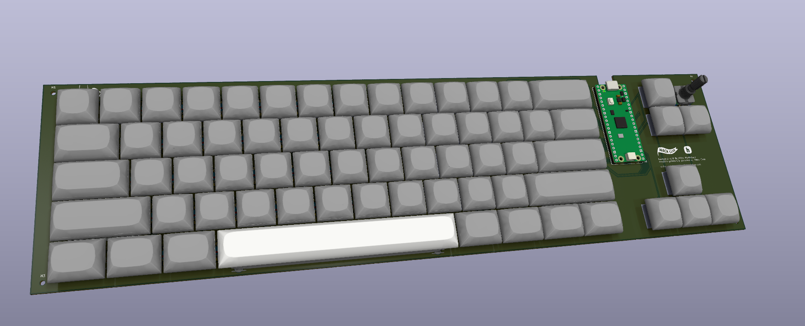

# keyboard
A mechanical keyboard, designed by me, using [keeb's](https://keeb.hackclub.com) tutorial (for basic overview and guidance; once I knew the general direction to take each step it was mostly independent).
Mx style switches, in a slightly-larger-than 60% layout, designed with a select few extra keys I deemed important.
Additionally features a rotary encoder for volume & media playback.

Using [RMK](https://rmk.rs/docs/user_guide/guide_overview) for firmware.

## Firmware setup
Make sure the rust toolchain is installed. Install the compilation target for your microcontroller; in our case it's a pi pico 1 so it'll be `thumbv6m-none-eabi`

Install rmk deps:
```sh
cargo install rmkit
cargo install flip-link cargo-make
```
The firmware is already configured for this specific board layout and pinout, etc. 

Build firmware with 
```sh
cargo make uf2 --release
```
You'll find the compiled uf2 (which can be loaded normally to the pi pico) at `target/thumbv6m-none-eabi/release/*.uf2`

**BOM:** [BOM.csv](BOM.csv)





## Bill of Materials

| Item | Price |
| --- | ---: |
| [PI Pico Starter Kit](https://www.amazon.com/KEYESTUDIO-Raspberry-Starter-Headers-Breadboard/dp/B0861WJ2DD) | $9.45 |
| [PCB (jlcPCB)](https://jlcpcb.com) | $23.30 |
| [EC11 Rotary Encoder](https://keeb.io/products/rotary-encoder-ec11) | $1.99 |
| [Through-hole 1N4148 Diodes (100-pack)](https://keeb.io/products/1n4148-diodes) | $2.99 |
| [MX Plate Mount Stabilizers](https://www.amazon.com/DUROCK-Stabilizer-Innovative-Pre-clipped-Stabilizers/dp/B0CTHT34MJ) | $9.99 |
| [DSA Keycap set](https://www.amazon.com/YMDK-Profile-Keyset-Mechanical-Keyboard/dp/B07GP29DQF) | $22.50 |
| [Cherry MX Tactile Brown RGB GEN 2 switches (2 packs)](https://www.microcenter.com/product/708639/cherry-mx-tactile-brown-rgb-gen-2-key-switches) | $39.98 |
| [M3 brass heat-set inserts (3 mm long; 50-pack)](https://www.adafruit.com/product/4256) | $5.95 |
| **Subtotal** | **$116.15** |

